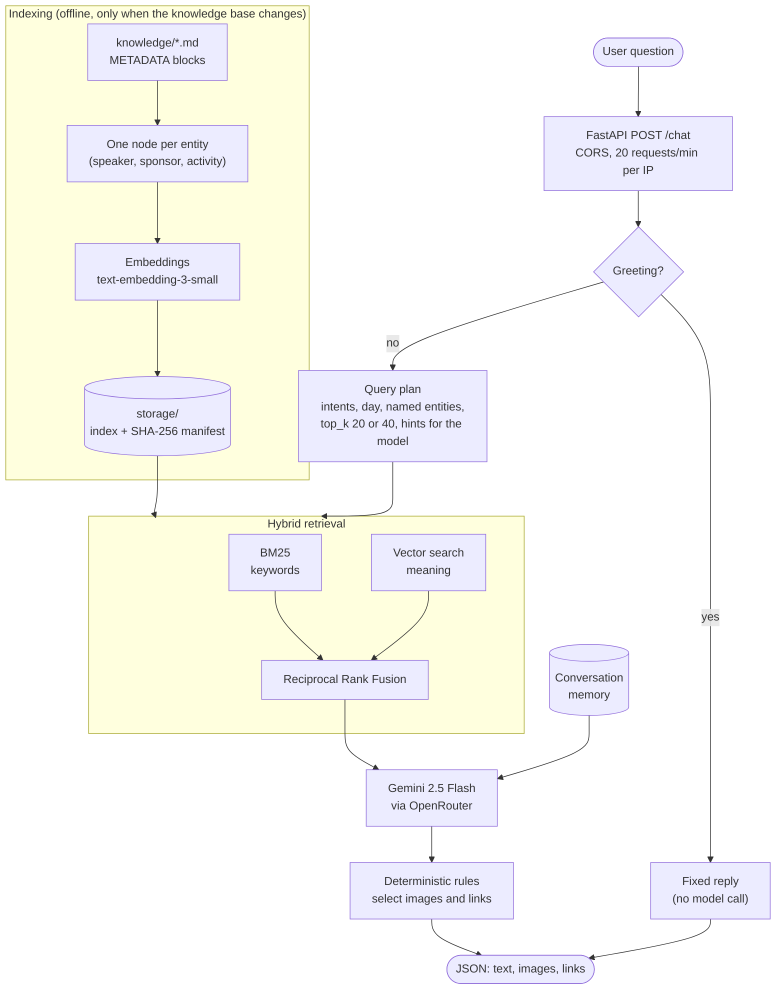

# LIFE Design Festival 2026 — Website and AI Curator

Official website of the **LIFE Design Festival 2026** (Potenza, Italy, 5–6 June 2026) and its
**AI Curator**, a chat assistant that answers questions about speakers, sponsors, program and
logistics using retrieval-augmented generation (RAG).

**Live site:** [lifedesignfestival.it](https://lifedesignfestival.it)

<!-- Screenshots (to be added in docs/images/):


-->

The repository is a monorepo with two independent applications:

| | Stack | Hosting |
|---|---|---|
| `frontend/` | React 18, TypeScript, Vite, Tailwind CSS | Vercel |
| `backend/` | Python 3.12, FastAPI, LlamaIndex, OpenRouter | Render |

---

## Project structure

```
life-design-scroll/
├── backend/                     FastAPI API + AI Curator (RAG)
│   ├── main.py                  /chat and /health endpoints, CORS, rate limiting
│   ├── requirements.txt         direct dependencies, pinned
│   ├── core/
│   │   ├── config.py            settings from environment variables
│   │   ├── edition.py           loads the edition data (dates, links, team, images)
│   │   ├── engine.py            RAG engine: index, hybrid retrieval, conversation memory
│   │   ├── ingest.py            indexing of the knowledge base and index manifest
│   │   ├── intents.py           intent detection on the user question
│   │   ├── registry.py          speaker and sponsor catalog built from the knowledge base
│   │   └── resolver.py          deterministic rules that select images and links
│   ├── data/
│   │   ├── edition.json         edition-specific data, kept out of the code
│   │   └── system_prompt.md     instructions for the language model
│   ├── knowledge/               knowledge base (4 Markdown files, in Italian)
│   └── storage/                 prebuilt vector index + manifest
├── frontend/                    React website
│   ├── index.html
│   ├── public/                  images, fonts, favicon, robots.txt, sitemap.xml
│   └── src/
│       ├── components/
│       │   ├── layout/          navbar, custom cursor
│       │   ├── sections/        the 10 sections of the page
│       │   ├── widgets/         AI Curator chat, countdown
│       │   └── paint/           drawing canvas and toolbar
│       ├── context/             shared state of the drawing tool
│       ├── data/                speakers, sponsors, program
│       ├── hooks/               smooth scrolling (Lenis), image preloading
│       └── pages/               main page and 404
└── docs/
    └── CURATOR_SPEC.md          behaviour specification of the AI Curator (Italian)
```

---

## Frontend

A single-page website built with **React 18 + TypeScript + Vite** and styled with
**Tailwind CSS**. Animations use **GSAP** (scroll-triggered entrances, timelines, parallax)
and **framer-motion** (enter/exit transitions); smooth scrolling uses **Lenis**.

**Page sections**, in order: hero, about, countdown, speakers, program, location, a gallery
of the previous edition (photos follow the mouse), tickets, accommodation, sponsors, footer.
Speakers open in a full-screen dialog (Radix UI); the program is a two-day timeline that
fills in while scrolling and collapses into accordions on mobile.

**AI Curator chat** (`components/widgets/ChatWidget.tsx`)
- a draggable input bar on desktop and a floating button on mobile;
- a full-page conversation view with Markdown answers (`react-markdown`), plus the images and
  links returned by the backend: composite galleries and the sponsor wall in full width,
  speaker portraits and sponsor logos side by side, links as buttons;
- a random session id per visit, so the backend can keep the conversation context.

**Drawing tool** (`components/paint/`): visitors can draw on the page, switch between
drawing and browsing, undo and clear. Strokes are stored in page coordinates and redrawn
on scroll, so they stay attached to the content; strokes drawn inside a speaker dialog
belong to that dialog.

Content (speakers, sponsors, program) is static data in `src/data/`. The site is deployed
on Vercel, with long-term caching for assets and fonts (`vercel.json`).

---

## Backend

A **FastAPI** service that wraps a RAG engine built with **LlamaIndex**. The language model
is **Gemini 2.5 Flash** and the embeddings are **text-embedding-3-small**, both through
**OpenRouter**.

### How a question is answered



### Design choices

- **The model writes the text; the code chooses images and links.** After the answer is
  generated, `resolver.py` applies fixed rules: a question about all sponsors gets the
  sponsor wall, a question about one day gets that day's program galleries, a question that
  names speakers or sponsors gets exactly their portraits, logos and websites, in the order
  they were mentioned. The model never invents a URL or an image path. The complete rule set
  is in [`docs/CURATOR_SPEC.md`](docs/CURATOR_SPEC.md).
- **Entity-based indexing.** The knowledge base is split on its `METADATA` blocks, so each
  speaker, sponsor and activity is a self-contained node carrying its own id, image and
  website.
- **Hybrid retrieval.** BM25 matches names and exact terms; vector search matches meaning
  ("where can I sleep?" finds the accommodation section). Results are merged with
  Reciprocal Rank Fusion. Broad questions (full program, afternoon, all speakers) retrieve
  40 nodes instead of 20.
- **Conversation memory.** One memory buffer per session id, expiring after one hour, so
  follow-up questions keep their context.
- **Versioned index.** The vector index is committed in `backend/storage/` together with a
  manifest of SHA-256 hashes of the knowledge files. At startup the backend loads the index
  if the hashes match and rebuilds it only if the knowledge base has changed, so a deploy or
  a restart does not pay for embeddings again.
- **Data separated from code.** Everything that changes between editions (dates, ticket and
  social links, team, gallery images, words that need a capital letter to count as a name)
  lives in `data/edition.json` and `knowledge/`.

### API

| Method | Path | Description |
|---|---|---|
| `POST` | `/chat` | `{"message": str, "session_id": str}` → `{"text", "images", "links", "source"}` |
| `GET`, `HEAD` | `/health` | Health check for uptime monitors |

In production the API accepts requests only from the official domains, limits each client
to 20 requests per minute, rejects messages longer than 500 characters and disables the
interactive documentation (`/docs`). If the engine cannot start, the server does not start.

---

## Running locally

Requirements: **Python 3.12**, **Node.js 18+** and an [OpenRouter](https://openrouter.ai) API key.

**Backend** (http://localhost:8000)

```bash
cd backend
python -m venv .venv
source .venv/bin/activate        # Windows: .venv\Scripts\activate
pip install -r requirements.txt
cp .env.example .env             # then set OPENROUTER_API_KEY
python -m uvicorn main:app --port 8000
```

**Frontend** (http://localhost:8080)

```bash
cd frontend
npm ci
cp .env.example .env             # VITE_API_URL, defaults to http://localhost:8000
npm run dev
```

After editing a file in `backend/knowledge/`, rebuild the index with
`python -m core.ingest` from the `backend` folder (this calls the embedding API). The
backend also does it automatically at startup when the manifest no longer matches.

---

## Known limitations

- **AI Curator**
  - A time slot without a day ("what's on in the morning?") shows all four program
    galleries instead of the two morning ones.
  - Follow-up questions ("and in the afternoon?") keep their context in the text, but images
    are chosen from the current question only.
  - A question that names both festival days shows the galleries of the first day only.
  - Names that are also common Italian words (e.g. *Brutto*, *Cosmico*) are recognised only
    when capitalised, so they can be mistaken for a name at the start of a sentence.
- **Frontend**
  - The JavaScript bundle is a single 700 kB file (235 kB gzipped); code splitting the chat
    and the drawing tool would reduce the initial load.
  - Two animation libraries (GSAP and framer-motion) coexist.

---

## Credits and license

Design and development: **Alessandro Del Moro**.
Content, photos and logos belong to the LIFE Design Festival and to their respective owners.

© 2026 Alessandro Del Moro. **All rights reserved.** See [`LICENSE`](LICENSE).
