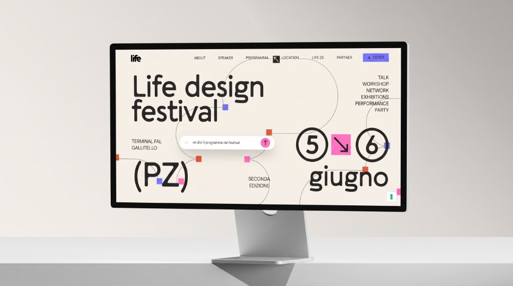
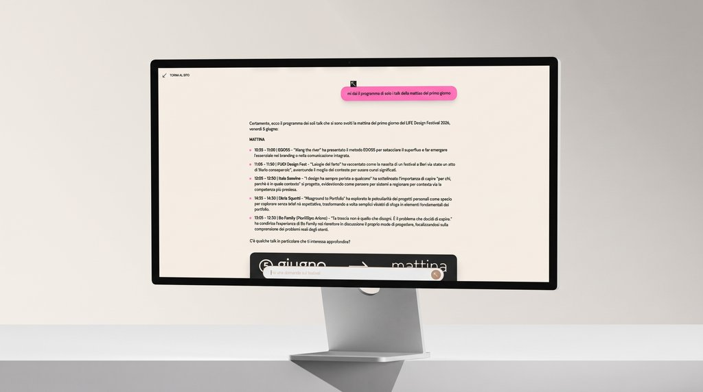
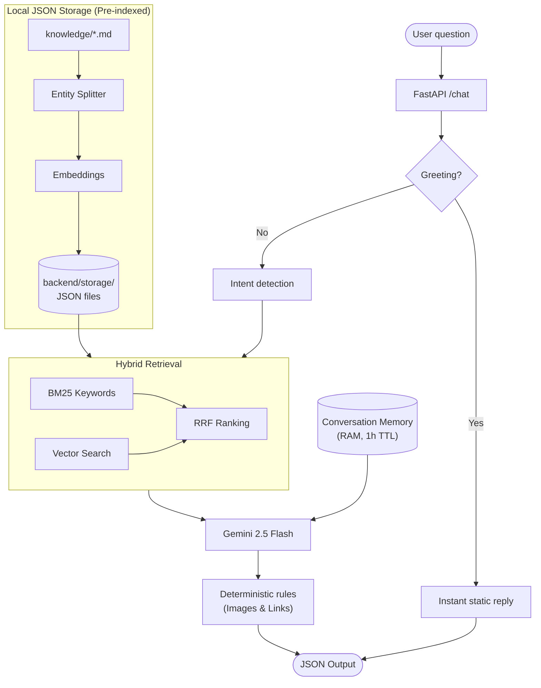

# LIFE Design Festival 2026 — Website and AI Curator

Official website of the **LIFE Design Festival 2026** (Potenza, Italy, 5–6 June 2026) and its
**AI Curator**, a chat assistant that answers questions about speakers, sponsors, program and
logistics using retrieval-augmented generation (RAG).

**Live site:** [lifedesignfestival.it](https://lifedesignfestival.it)

The repository is a monorepo with two independent applications:

| | Stack | Hosting |
|---|---|---|
| `frontend/` | React 18, TypeScript, Vite, Tailwind CSS | Vercel |
| `backend/` | Python 3.12, FastAPI, LlamaIndex, OpenRouter | Render |

---

## Frontend

A single-page website built with **React 18 + TypeScript + Vite** deployed on **Vercel** and styled with **Tailwind CSS**. Animations use **GSAP** and **framer-motion**; smooth scrolling uses **Lenis**.



```
frontend/
├── public/                      fonts, images, favicon, robots.txt, sitemap.xml, llms.txt
└── src/
    ├── components/
    │   ├── layout/              navbar, custom cursor
    │   ├── sections/            the 10 sections of the page
    │   ├── widgets/             RAG input UI, countdown
    │   └── paint/               drawing canvas and toolbar
    ├── context/                 shared state of the drawing tool
    ├── data/                    speakers, sponsors, program
    ├── hooks/                   smooth scrolling (Lenis), image preloading
    └── pages/                   main page and 404
```

**Page sections**: hero, about, countdown, speakers, program, location, previous edition gallery, tickets, accommodation, sponsors, footer.

**RAG input UI** (`components/widgets/ChatWidget.tsx`): a draggable prompt bar on desktop and floating button on mobile that expands into a full-screen conversational modal. It renders rich Markdown responses, dynamic image galleries, and action buttons returned by the backend, tracking multi-turn dialogs via ephemeral session IDs.

**Drawing tool** (`components/paint/`): a full-screen HTML5 Canvas overlay powered by React Context. Vector strokes are recorded in absolute document coordinates and re-rendered via `requestAnimationFrame` in sync with Lenis smooth-scroll, keeping artwork anchored to page content and dialogs.

---

## Backend

A **FastAPI** service that wraps a RAG engine built with **LlamaIndex**. The language model is **Gemini 2.5 Flash** and the embeddings are **text-embedding-3-small**, both served through **OpenRouter**.



```
backend/
├── main.py                      FastAPI endpoints, CORS, rate limiting
├── core/
│   ├── config.py                settings and environment variables
│   ├── edition.py               loads edition metadata, links and assets
│   ├── engine.py                RAG engine: index, hybrid retrieval, memory
│   ├── ingest.py                offline indexing and SHA-256 manifest
│   ├── intents.py               intent detection on user queries
│   ├── registry.py              speaker and sponsor catalog
│   └── resolver.py              deterministic rules for images and links
├── data/                        edition.json, system_prompt.md
├── knowledge/                   knowledge base (4 Markdown files)
└── storage/                     pre-indexed JSON files (vectors and docstore)
```

### How the RAG works

The service implements a hybrid retrieval engine combining **BM25 keyword search**  and **vector search** , loaded into memory from committed JSON files that map embedding arrays directly to text chunks.

Official image galleries and links are never generated by the model: they are attached through **deterministic rules** driven by intent detection and entity metadata.



### API

| Method | Path | Description |
|---|---|---|
| `POST` | `/chat` | `{"message": str, "session_id": str}` → `{"text", "images", "links", "source"}` |
| `GET` | `/health` | Service health check |

In production, requests are rate-limited (20 req/min per IP) and restricted via CORS to official festival domains.

---

## Running locally

**Prerequisites:** Python 3.12, Node.js 18+, and an [OpenRouter](https://openrouter.ai) API key.

### Backend (http://localhost:8000)

```bash
cd backend
python -m venv .venv
source .venv/bin/activate        # Windows: .venv\Scripts\activate
pip install -r requirements.txt
cp .env.example .env             # add your OPENROUTER_API_KEY
python main.py
```

### Frontend (http://localhost:8080)

```bash
cd frontend
npm ci
npm run dev
```

---

## Credits and license

Designed by **Fiiico studio**  
Developed by **Alessandro Del Moro**  
Content, photos and logos belong to the LIFE Design Festival and to their respective owners.

© 2026 Alessandro Del Moro. **All rights reserved.** See [`LICENSE`](LICENSE).
